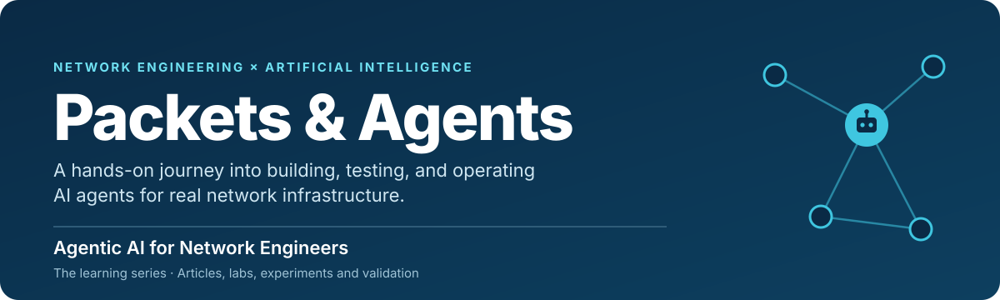

<p align="center">
  
</p>

<p align="center">
  <strong>🏗️ Build it. &nbsp;🧪 Test it. &nbsp;✅ Validate it.</strong><br>
  Learn how AI agents can assist with network operations, and how to verify that their decisions and actions are safe, correct, and repeatable.
</p>

<p align="center">
  <a href="https://titusm.github.io/packets-and-agents/"><strong>📖 Read Article 01</strong></a>
</p>

---

## 🎯 Who this is for

Practicing network engineers and learners with basic routing and switching knowledge. No prior AI development experience is assumed for the first articles. Later labs introduce Python, model APIs, restricted tools, and test frameworks step by step.

This is not a video course. The learning material is made of approachable articles, simple diagrams, reusable network labs, downloadable source code, real execution traces, and validation evidence that readers can repeat using CML, EVE-NG, or another suitable lab platform. Some labs may need platform-specific adjustments.

## 🧭 How the series works

1. **🔍 Start with a real engineer's question.** Familiar incidents come before AI terminology.
2. **🛠️ Show the work.** Topology, configurations, code, tool outputs, assertions, and sanitized traces let readers reproduce each experiment.
3. **⚖️ Keep the agent and the evaluator separate.** The Agent Under Test investigates and proposes or executes authorized actions. An Independent Evaluator checks the outcome, the network state, and the safety rules. The agent never grades its own success.
4. **🔬 Be honest about evidence.** A scripted test double can verify an evaluation framework, but it does not measure the reliability of a real AI model. Results are labeled as real model on a simulated network, real model on a live lab, or scripted fixture.
5. **🔐 Keep operational controls.** Human approval, device-scoped access, command restrictions, rollback, and independent verification stay in place even when an agent is capable of acting.

## 📚 Articles

| # | Title | |
|---:|---|---|
| 01 | Agentic AI for Network Engineers: Where Do We Begin? | [Read online](https://titusm.github.io/packets-and-agents/) · [Markdown source](article-01.md) |

New articles are added here as they are published.

## 🗂️ Repository layout

```text
.
├── README.md
├── index.html                 # Article 01, self-contained, served by GitHub Pages
├── article-01.md              # Editable source for Article 01
└── assets/
    ├── banner.svg             # README banner
    └── article-01/            # The six illustrations
```

## 🚀 Publishing with GitHub Pages

Pages is served from the root of the `main` branch, so `index.html` is the landing page. The page is self-contained because its illustrations are embedded.

When a second article is added, the root `index.html` will become a series landing page and each article will move to its own folder (for example `article-01/index.html`).

`article-01.md` is the editable source and `index.html` is the published page. When the Markdown changes, update the HTML to match so the two never disagree.

## 📝 Notes

- All examples are original or appropriately licensed, sanitized, and reproducible. No customer configurations, credentials, or confidential material are published here.
- Illustrations in Article 01 are conceptual teaching aids, not captured lab results.
- No autonomous production changes are recommended anywhere in this series.
