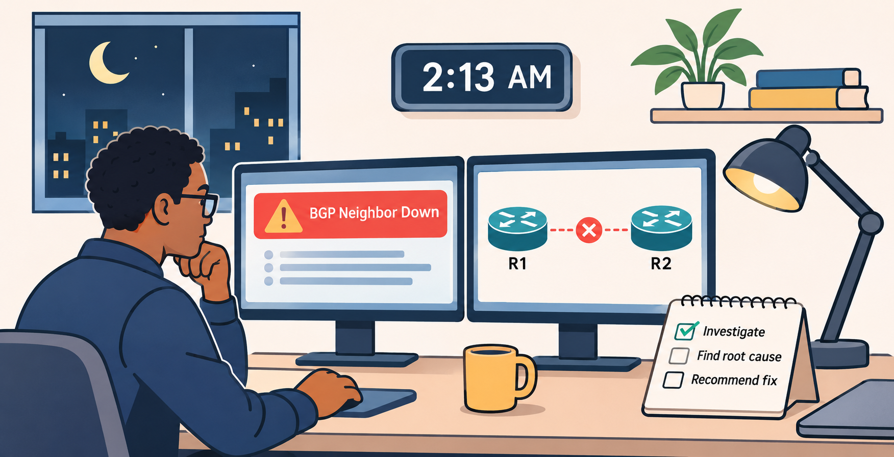
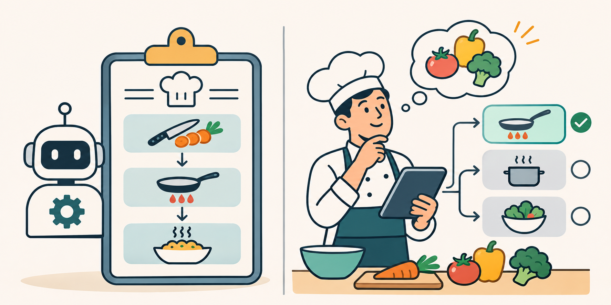
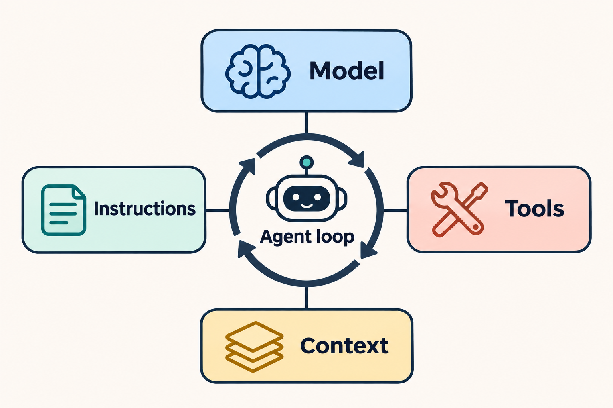
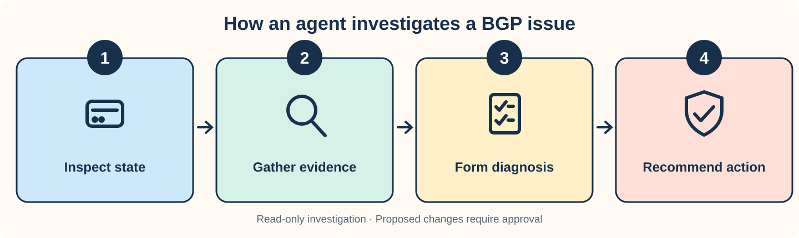
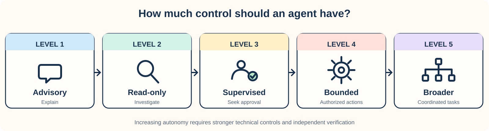
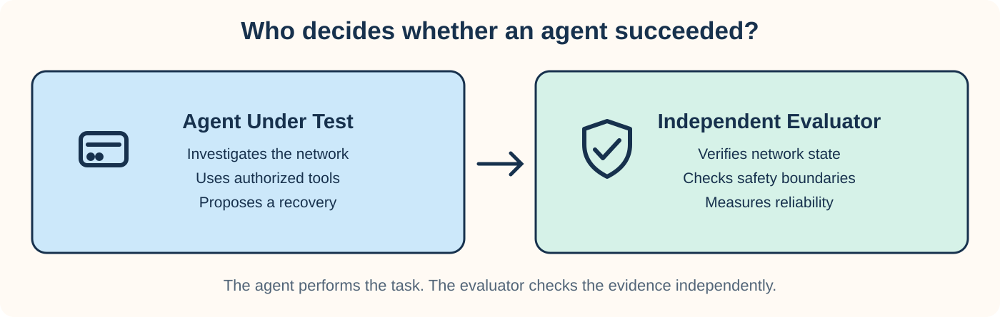

# Agentic AI for Network Engineers: Where Do We Begin?

**Agentic AI for Network Engineers · Article 01**  
*Understanding the technology, the people-and-process problems it could help with, and why network engineers need to learn how to test it.*

**Author:** Titus Majeza  
**Audience:** Network engineers and curious beginners  
**Reading time:** About 10 minutes  
**Prerequisites:** Basic networking knowledge. No AI development experience required.

---

## 1. It is 2:13 AM. BGP Goes Down.

**BGP Neighbor Down: Critical.**

You know the routine. Open the monitoring system. Log in to the router. Check the neighbor state. Look at the interface. Scan the logs. Ask whether anyone changed something earlier in the evening.

At this stage, the alert tells you *what* happened, but you still have to figure out *why*.

Now imagine a colleague sitting beside you. You say, "Can you investigate this BGP failure and bring me the evidence? Do not change anything yet."

That colleague starts with the neighbor state, discovers something unusual, checks the configuration, and comes back with a diagnosis and a recommended next step.

Now imagine that colleague is an AI agent with access to carefully restricted network tools.

That is the idea we will explore in this series.

*Figure 1. Our fictional 2:13 AM incident. This is a conceptual illustration, not a screenshot from a live test.*

The question behind this illustration is simple: **can software gather evidence, choose sensible troubleshooting steps, and explain its findings without stepping outside its authority?**

## 2. So, what is Agentic AI?

You have probably asked an AI assistant to explain a routing concept or interpret a CLI output. You provide a question or some data, and the model generates a response.

An **AI agent** goes further by using a language model to work toward a goal across multiple steps. The model decides for itself which tool to use next, and the tools let it retrieve information or perform permitted actions.

For example, you might ask an ordinary assistant, "What causes a BGP neighbor to stay in Idle?" It can explain possibilities.

An agent, connected to the right tools, can be asked, "Investigate why neighbor 192.0.2.2 is down." It might inspect the session, check the underlying interface, read relevant configuration, and decide which observation to follow up on.

The model does not connect to routers by magic. The surrounding application provides defined tools and controls what those tools can actually do. OpenAI's *Practical Guide to Building Agents* and Anthropic's *Building Effective Agents* both discuss these model-and-tool patterns.[1][2]

### The cooking analogy

Think about making dinner.

A **traditional automation script** resembles a recipe: chop, heat, cook, serve. Every step and every branch is written in advance. That is excellent when the job is well understood and repeatable.

An **AI agent** is more like a cook who knows the desired outcome and checks what is happening along the way. If an ingredient is missing, the cook considers another route. If the food needs more time, the cook adjusts.

That flexibility can be useful in troubleshooting, where each answer can raise another question. But an adaptive cook can still make a bad decision. Flexibility does not guarantee good judgment.

*Figure 2. Left: automation follows fixed steps, like a robot working through a recipe. Right: an agent, like a cook, checks what is happening and chooses the next step. Both approaches have a place in engineering.*

This is why we will not spend the series trying to turn every Python script into an agent. Sometimes a script is exactly the right tool.

## 3. What is actually inside an AI agent?

At its most fundamental level, an AI agent is a large language model (LLM) running in a loop: it decides on a step, uses a tool, observes the result, and decides again. Guardrails are what keep that loop safe. Strip away the buzzwords and you will find a handful of understandable parts.

**The model** is the part that interprets the objective and selects the next step. Think of it as the decision engine, with real limitations: it can misunderstand evidence or recommend an inappropriate action.

**The tools** are how the agent interacts with other systems. In network operations, these might be restricted functions using SSH, REST APIs, pyATS (with its Genie parsers), or monitoring platforms. A tool could be as narrow as `get_bgp_neighbors(device)`.

**The instructions** tell the agent what job it is performing and how it should behave: collect evidence before suggesting a fix, identify uncertainty, and do not change configurations without approval.

**The context** is the information available for the current task: the device inventory, the user's request, prior observations, documentation, and tool outputs. Missing or stale context can lead to poor decisions.

**The agent loop** ties it together: observe, decide on the next useful step, use a tool if needed, inspect the result, and continue or stop. A well-designed loop also has a stop rule, such as a maximum number of steps and permission to answer "I cannot tell from the evidence." Without one, an agent can keep trying.

*Figure 3. The basic building blocks. This is a simplified teaching model, rather than a product-specific architecture.*

One detail is worth remembering: **an instruction is not the same as an enforced permission.** Telling an agent "do not configure devices" is useful guidance. Giving its tool adapter only read-only commands is a stronger boundary. The strongest boundary sits on the device itself: a read-only account or role means the device refuses a write even if the adapter has a flaw. Even a show command is not always harmless, because some platforms let you redirect its output to a file, and a heavy command can load the CPU. The safest tool is one that does not exist. If the agent has no `push_config` tool, no instruction can talk it into using one.

## 4. Back to our BGP incident

Let us make the example more concrete. Picture two routers, R1 and R2, that are expected to maintain a BGP session.

Suppose we deliberately shut down R1's BGP neighbor entry for R2 in a practice lab. We then ask an AI agent:

> Investigate the failed BGP adjacency between R1 and R2. Find the likely cause, show the supporting evidence, and recommend a recovery step. Do not make configuration changes. If the evidence does not explain the failure, say so and list where you looked.

A reasonable investigation might look like this:

**First, inspect the state.** The agent requests BGP neighbor information. It confirms that the peer is not Established.

**Next, gather more evidence.** It checks relevant interface and configuration details rather than guessing that every down neighbor is a connectivity problem.

**Then, form a diagnosis.** It notices that the neighbor is administratively shut down, confirms the configuration, and explains why that condition prevents the session from establishing.

**Finally, recommend a response.** It advises reviewing the intended configuration and enabling the neighbor only through an approved process, if the shutdown was unintended.

*Figure 4. An illustrative troubleshooting path. We have not yet run this sequence as a measured AI agent experiment in this article.*

Notice that the agent is not useful merely because it can run a show command. The value comes from choosing a relevant follow-up, connecting observations to the possible cause, and knowing when to stop.

Of course, this example is deliberately simple. Real BGP incidents can involve routing policy, reachability, authentication, remote configuration, and wider service impact. We will increase the complexity in later articles.

## 5. What about the automation we already use?

If you are a network engineer, you may already use Python, Ansible, Robot Framework, pyATS, or CI/CD pipelines. Those skills remain extremely useful. Many teams also already have runbooks. A runbook is a natural source for an agent's instructions: the ordered steps, who gets what, and where it stops.

Suppose you need to verify that 200 devices have the correct NTP settings. A deterministic script can check every device using explicit assertions. The workflow is predictable, auditable, and usually inexpensive to run.

Now suppose the objective is, "Explain why this service degraded after last night's change." The investigation might require information from BGP, interfaces, logs, application monitoring, and change history. There may be no single fixed troubleshooting sequence that covers every situation.

That is a more promising place to experiment with an agent: let the model decide which *approved* tool to call next, while keeping the collection, validation, and enforcement mechanisms deterministic where possible.

Anthropic's engineering guidance similarly recommends choosing simpler workflows when they are sufficient and introducing agentic flexibility only when it has a clear benefit.[1]

## 6. How much control should we give it?

Imagine a new engineer joining your team. You would not necessarily give them unrestricted access to every production switch on their first morning. You would explain procedures, assign appropriate permissions, review their work, and gradually expand responsibilities.

That is a useful analogy for agent autonomy, too.

*Figure 5. Five illustrative autonomy stages for this course, not an official industry classification.*

For our first practical agent, we will stay at the read-only stage. That gives us plenty to learn without introducing unnecessary device risk.

## 7. What if the agent gets it wrong?

Here is where my interest in network validation comes in.

Imagine the agent correctly discovers a BGP configuration error. It proposes a fix, and the session comes up. Good news, right?

Now suppose it also changed an unrelated neighbor's configuration along the way. This assumes an agent with write access, which our first read-only agent will not have.

The original alert is cleared, but the agent crossed a safety boundary. We should not call that execution a success. An enforced read-only role would have prevented the change, and an independent evaluator is how we catch it when prevention is missing or incomplete.

Think of a driving test. Reaching the destination matters. So does obeying traffic lights, checking before turning, and not putting other road users at risk. The examiner judges both the outcome and the driving.

We will apply a similar idea to network agents with two distinct roles:

- **Agent Under Test:** investigates the problem and performs only the operations it is authorized to perform.
- **Independent Evaluator:** compares the agent's observed behaviour and the network's measured state against separately defined expectations.

*Figure 6. Two separate responsibilities: the agent investigates, while an independent evaluator verifies the outcome and safety. Conceptual illustration.*

The evaluator should not rely on the agent's own claim that everything worked. It should independently check the outcome with network-state assertions, traffic observations, configuration comparisons, and tool-execution records.

And it should run scenarios more than once. A single polished demo is a starting point, not a reliability measurement.

Reading about agents quickly raises four families of risk:

- **Reliability:** the model can hallucinate, lose context, or give different answers to the same question.
- **Security:** the access that makes an agent useful also creates attack surface, including prompt injection and misused credentials.
- **Governance:** if an agent causes an outage, "the AI decided" is not an acceptable explanation, so we need records of what it did and why.
- **Operational:** token costs, latency, and ongoing maintenance add up, especially if an agent gets stuck in a retry loop.

We will return to each of these later in the series.

None of this is an argument against agents. Faster response, scalability, and consistent operations are potential benefits, and the purpose of controls, risk awareness, and testing is to earn them safely.

## 8. Why explore this now?

Modern network operations span physical networks, virtual fabrics, cloud environments, automation systems, and a growing volume of operational data. Investigations can cross multiple tools and teams.

There is also evidence that organizations are actively exploring agent-driven operations. Cisco's September 2026 announcement about research conducted by Omdia reported that **51% of the 1,000 surveyed IT and network operations leaders** said their organizations ran agentic AI that acted in production. The survey covered organizations with at least 500 employees.[3]

That is a reported survey result. It is not proof that those agents were independently tested, safe, or successful. Still, it helps explain why questions about tool access, explainability, monitoring, and verification are becoming relevant.

I see a natural role for network engineers here. We understand what normal protocol behaviour looks like, how faults propagate, why change boundaries matter, and how to distinguish a convincing explanation from a validated result.

Those skills are exactly what we need when an AI system starts interacting with network infrastructure.

## 9. What we will build together

This series will be written for people who want to learn by doing. You will be able to follow the experiments using CML, EVE-NG, or another suitable lab platform, alongside Python and accessible model APIs.

We will progress through four stages:

1. **Understand.** Learn models, tools, context, instructions, and how an agent executes a task.
2. **Build.** Connect a real model-driven agent to restricted network-state tools.
3. **Validate.** Inject faults, compare diagnoses against independent evidence, and measure safety and repeatability.
4. **Operationalize.** Add traces, reporting, approval gates, and automated regression checks.

Later articles will include topology files, configurations, code, sample traces, and report artifacts. Where a result comes from simulation or a scripted test double, it will be labeled as such. We will not present those results as measurements of a real AI model.

## 10. A thought experiment before Article 2

Imagine you give a read-only agent this task:

> Investigate why BGP neighbor 192.0.2.2 is down.

It checks the neighbor state and immediately replies: "Restart the BGP process."

Would you accept that recommendation?

I would want to know what evidence supports it. Is the interface up? Is the remote AS correct? Is the peer reachable? Has someone intentionally shut down the session? Could restarting the process disrupt healthy neighbors?

An agent that asks those questions and gathers the relevant evidence is much more useful than one that confidently guesses.

And when the agent makes a bad call, we will need a way to recognize it, measure it, and learn from it.

## Final thoughts

What draws me to Agentic AI is the possibility of connecting intelligent decision-making with network tools we already understand and trust. I also find the unanswered questions exciting: how do we limit risk, establish evidence, and decide when an agent is ready for more responsibility?

This series will take those questions one experiment at a time. We will start with the fundamentals, build real agents, challenge them with network conditions, and report what we can actually demonstrate.

No claims of perfect autonomy. Just practical networking, repeatable experiments, and lessons worth sharing.

**Coming next: Article 02. The Anatomy of a Network AI Agent: Models, Tools, Context, Instructions, and the Agent Loop.**

---

### Sources and further reading

[1] Anthropic, [*Building effective agents*](https://www.anthropic.com/research/building-effective-agents), December 19, 2024. Conceptual distinctions between workflows, agents, and tool use; the article itself notes that tooling has evolved since publication.  
[2] OpenAI, [*A practical guide to building agents*](https://openai.com/business/guides-and-resources/a-practical-guide-to-building-ai-agents/), January 15, 2026. Agent design components, tool integration, instructions, and guardrails.  
[3] Cisco Newsroom, [*Cisco AI Research: AgenticOps Scaling Quickly in the Enterprise*](https://newsroom.cisco.com/c/r/newsroom/en/us/a/y2026/m09/cisco-ai-research-agenticops-scaling-quickly-in-the-enterprise.html), September 23, 2026. Cisco's account of Omdia survey findings.

*Editorial note: This article contains original explanatory examples and six custom conceptual illustrations. The fictional BGP incident and diagrams are teaching aids, not claims about an executed lab. Source-linked technical concepts and survey results are attributed above.*
